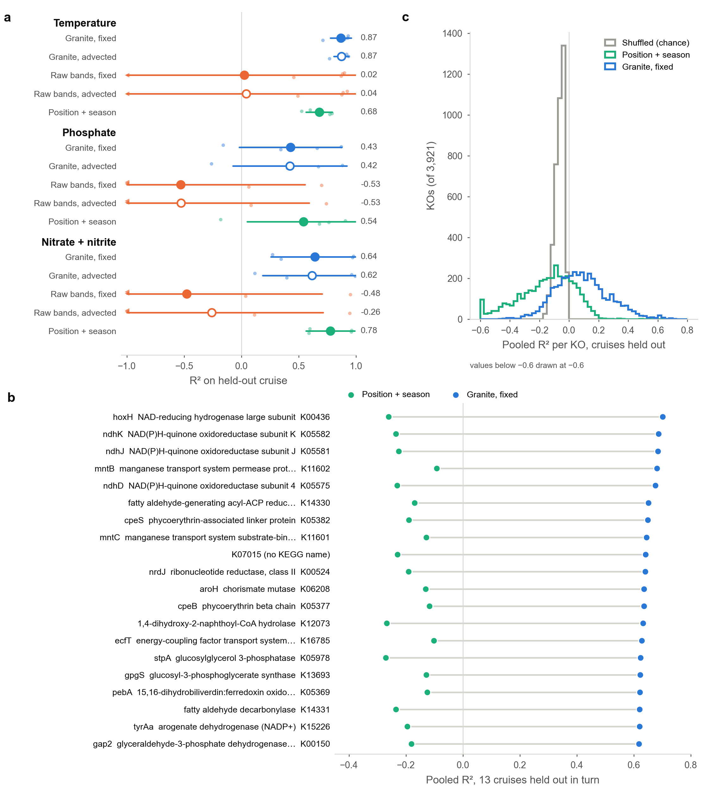
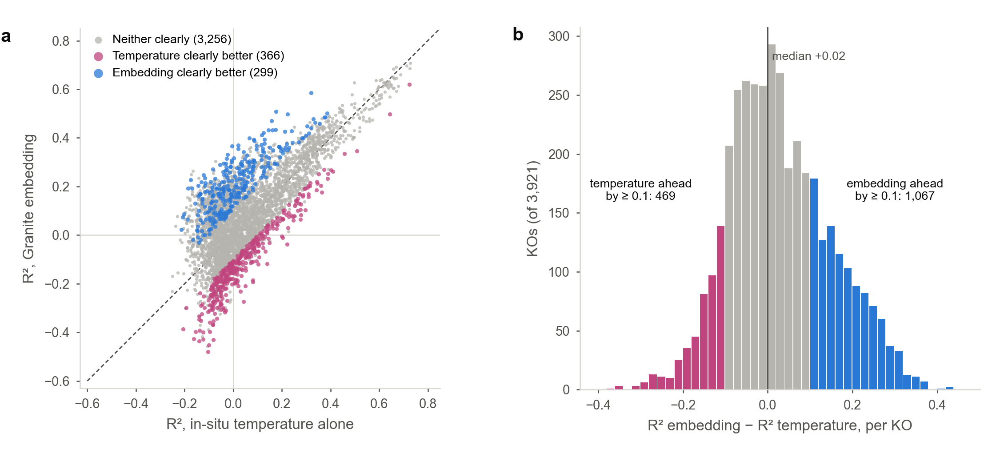
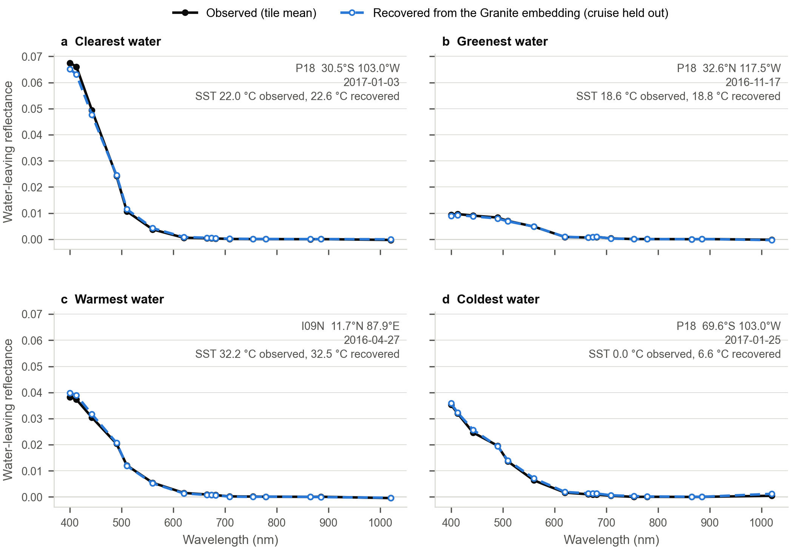
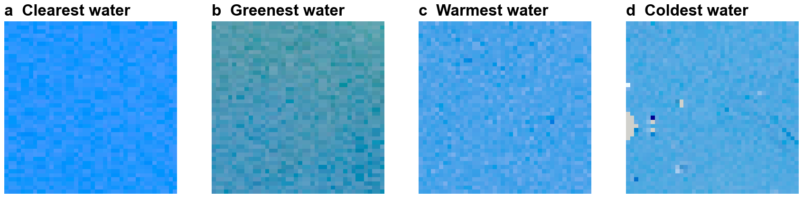
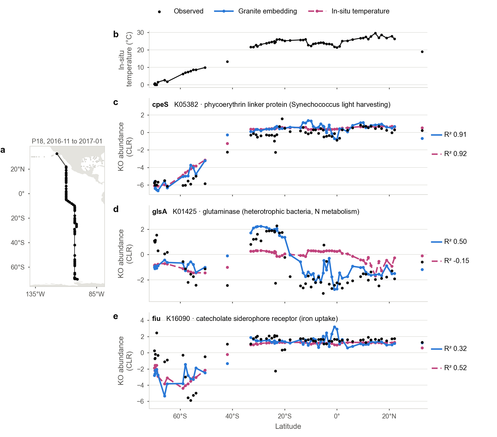
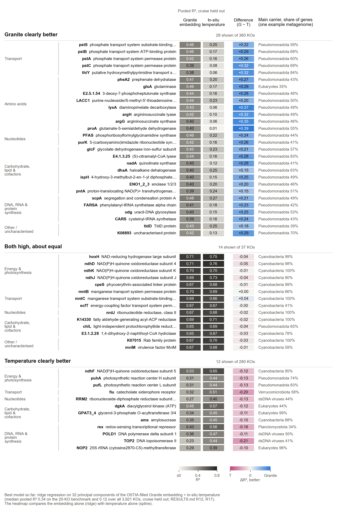
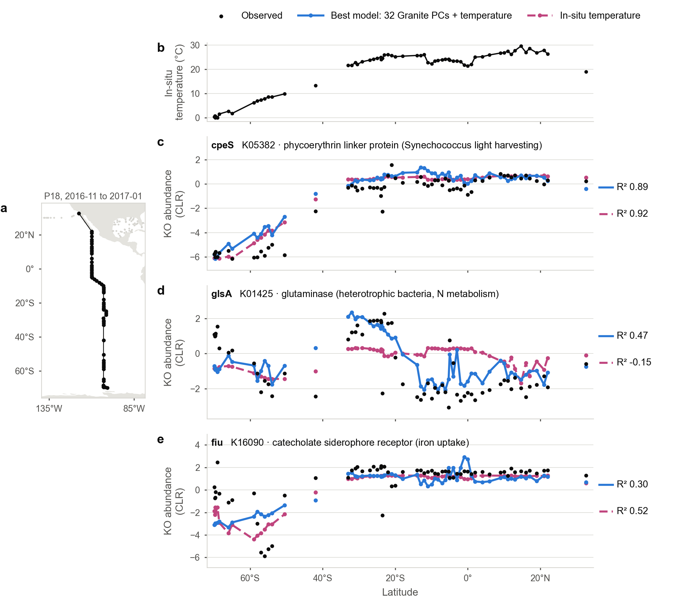
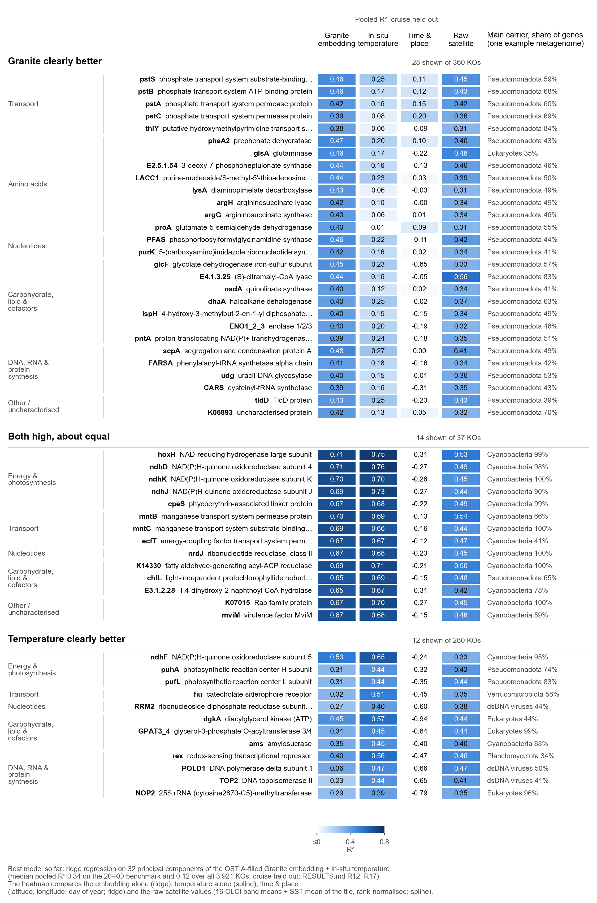

# Figures

One entry per figure: what it shows, the code that makes it, its inputs, and how
to regenerate it. Outputs go to `figures/output/` (committed). Inputs under
`data/` are not in git; they live on the cluster or are copied back as noted.

Shared conventions: Arial, no titles baked into the image (captions go in the
text), observed values in black, model-derived values in blue (#2a78d6) and dashed.

The figure scripts need numpy, pandas, matplotlib and scikit-learn. Run them with
a Python that has these; on the project owner's laptop that is
`/Users/hellpark/miniforge3/bin/python` (the default `python3` there lacks
matplotlib).

## Contents

| Figure | Script | Output | Result entry |
|---|---|---|---|
| Predictability: in-situ variables and KOs | `figures/make_predictability.py` | `figures/output/predictability.png`, `.pdf` | RESULTS.md R1.3, R3.1 |
| Spectral recovery from Granite embeddings | `figures/make_spectral_recovery.py` | `figures/output/spectral_recovery.png`, `.pdf` | METHODS_RESULTS.md section 7 |
| Natural-colour tiles (companion) | `figures/make_tile_rgb.py` | `figures/output/spectral_recovery_tile_rgb.png` | - |
| Embedding vs in-situ temperature, all KOs | `figures/make_temperature_gap.py` | `figures/output/temperature_gap.png`, `.pdf` | RESULTS.md R6 |
| Three KOs along a cruise line (P18) | `figures/make_cruise_line.py` | `figures/output/cruise_line.png`, `.pdf` | RESULTS.md R16 |
| KO heatmap: Granite vs temperature by function | `figures/make_ko_heatmap.py` | `figures/output/ko_heatmap.png`, `.pdf` | RESULTS.md R16 |
| Cruise line: temperature vs best model (P18) | `figures/make_cruise_line.py --compare best` | `figures/output/cruise_line_best.png`, `.pdf` | RESULTS.md R17 |
| KO heatmap: four predictors | `figures/make_ko_heatmap.py --columns inputs` | `figures/output/ko_heatmap_inputs.png`, `.pdf` | RESULTS.md R17 |

Colours shared by the prediction figures: Granite embedding blue `#2a78d6`, raw
band averages orange `#eb6834`, position + season aqua `#1baf7a`, chance grey
`#9a9993`, in-situ temperature magenta `#c0457e`; fixed position filled markers, advected hollow. Set at the top of
`figures/make_predictability.py` (`GRANITE`, `RAW`, `META`, `NULL`).

## Predictability: in-situ variables and KOs

- **Shows:**
  - **a** In-situ temperature, phosphate and nitrate + nitrite, original 5
    cruises, one cruise held out at a time: R2 per held-out cruise (small dots)
    and mean +/- s.d. over cruises (large marker and line; value at right) for the
    Granite embedding and the raw band averages at the fixed (filled) and advected
    (hollow) position, and for position + season. Values below -1 are drawn at -1
    as left-pointing markers (raw bands on I07N, about -3).
  - **b** The 20 KOs best predicted by the embedding over 13 cruises, labelled
    with KEGG gene symbol, name and KO: pooled R2 of the embedding (blue) against
    position + season (aqua).
  - **c** Pooled R2 of all 3,921 screened KOs for the embedding, position + season
    and the shuffled embedding (chance). Values below -0.6 drawn at -0.6.
- **Settings:** option A (closest-in-time tile with SST; tiles without SST not
  used), unique tiles, fixed position for b and c. Full settings: RESULTS.md R1.3
  (panel a) and R3.1 (panels b, c).
- **Code:** `figures/make_predictability.py`. Where to edit:
  - panel a: `panel_insitu()`; rows in `FEATURE_SETS` and `TARGETS`; floor `R2_FLOOR`.
  - panel b: `panel_top_kos()`; number of KOs `N_TOP_KOS`; label text `label_ko()`.
  - panel c: `panel_ko_distribution()`; bins and clipping in its first lines.
  - layout (panel positions, figure size): the `fig.add_axes` calls in `main()`.
- **Inputs:**
  - `data/results/sst_only_prefer/feature_set_comparison_section_unique_tiles.csv`
    from `python scripts/compare_feature_sets.py --require-sst --best-tile prefer-sst --out-dir data/results/sst_only_prefer`
  - `data/results/ko_screen/ko_screen.csv` from `python scripts/screen_ko_predictability.py`
    (needs `data/targets/ko_clr.csv` from `python scripts/build_ko_targets.py`)
  - `data/reference/kegg_ko_list.tsv`, KEGG KO names, downloaded from
    https://rest.kegg.jp/list/ko on first run (copy of 2026-11-04 in place).
- **Regenerate:** `python figures/make_predictability.py`
- **To switch to option B** (closest tile, SST-only): point `INSITU` at
  `data/results/sst_only_closest/...`; for the KO panels re-run the screen with
  `--best-tile closest --out-dir data/results/ko_screen_closest` and point `KO_SCREEN` there.

## Embedding vs in-situ temperature, all KOs

- **Shows:**
  - **a** Per KO (3,921): pooled R2 from in-situ temperature alone (x) against the
    Granite embedding (y), cruises held out in turn; dashed line = equal. Blue:
    embedding clearly better; magenta: temperature clearly better; grey: neither.
    "Clearly" = pooled R2 differs by at least 0.1 and the same side wins in at
    least 9 of the 13 held-out cruises. Values below -0.6 drawn at -0.6.
  - **b** Distribution of R2(embedding) - R2(temperature) over all KOs; bars
    beyond +/-0.1 coloured, counts beside them (by difference only, without the
    9-of-13 rule).
- **Settings:** RESULTS.md R6 (fixed position, option A tiles, samples with an
  in-situ temperature; temperature: best of ridge, spline + ridge, kNN;
  embedding: best of ridge, kNN).
- **Code:** `figures/make_temperature_gap.py`. Where to edit:
  - what counts as a clear win: `WIN_MARGIN`, `WIN_CRUISES`.
  - colours: `GRANITE`, `TEMP` (`#c0457e`), `NEUTRAL` at the top.
  - panel a: `panel_scatter()`; panel b: `panel_histogram()` (bins in its first line).
  - layout: the `fig.add_axes` calls in `main()`.
- **Inputs:** `data/results/ko_temperature_all/ko_temperature.csv` and
  `ko_temperature_per_cruise.csv` from
  `python scripts/test_ko_temperature.py --kos all --learners ridge spline knn --feature-sets temp embedding --out-dir data/results/ko_temperature_all`.
  Also writes `data/results/ko_temperature_all/ko_temperature_gap.csv` (per KO:
  both R2, difference, cruises won, verdict).
- **Regenerate:** `python figures/make_temperature_gap.py`

## Spectral recovery from Granite embeddings

- **Shows:** for four contrasting samples, the tile's observed mean water-leaving
  reflectance at each OLCI wavelength (black) and the same spectrum recovered
  linearly from the tile's 512-number Granite embedding (blue, dashed), with
  observed and recovered SST. Evidence that the embeddings retain the absolute
  colour and temperature of the water.
- **Method:** ridge regression from embedding to each channel's tile mean, over
  all 3,503 tiles, cross-validated with whole cruises held out (5 folds grouped by
  cruise); the plotted recovery for each tile comes from a model that never saw
  its cruise. Samples: among best fixed tiles at least 95% clear with SST and
  well-behaved visible reflectances (all positive, 560 nm above 0.002), the
  clearest and greenest (highest and lowest 443/560 nm ratio), the warmest and the
  coldest. Panel d shows the weakest case: at 0 C the recovered SST is 6.6 C,
  because very cold tiles are rare (Granite also excluded polar water from
  pretraining).
- **Code:** `figures/make_spectral_recovery.py`
- **Inputs:** `data/embeddings/` tile_embeddings.npy, tile_embeddings.csv,
  tile_raw_features.csv, sample_embeddings.csv (copied back from the cluster).
- **Regenerate:** `python figures/make_spectral_recovery.py`
- **Outputs:** `figures/output/spectral_recovery.png`, `.pdf`, and
  `spectral_recovery_tiles.csv` (the four tiles: sample, scene, date, position,
  tile path).

### Companion: natural-colour images of those four tiles

- **Shows:** the four 42 x 42-pixel tiles (12.6 km across) behind panels a-d, in
  natural colour with one shared stretch, so differences in colour are real:
  deep blue for the South Pacific gyre (a), blue-green off southern California
  (b), lighter blue for the Bay of Bengal (c) and the Antarctic margin (d). Flagged
  pixels are grey (a few at the left edge of d). The pixel-to-pixel speckle is
  sensor noise at 300 m; open-ocean tiles have little real structure at this
  scale.

- **Code:** `figures/make_tile_rgb.py figures/output/spectral_recovery_tiles.csv`
- **Inputs:** the four tile files listed in `spectral_recovery_tiles.csv`, copied
  from the cluster to the same relative paths under `data/tiles/`.
- **Output:** `figures/output/spectral_recovery_tile_rgb.png` (1 x 4 strip, shared
  colour stretch, flagged pixels grey).
- The full scenes (with a quick-look JPEG inside each archive) are the products
  named in the `granule_id` column, in `data/products/olci/` on the cluster.

## Three KOs along a cruise line (P18)

- **Shows:** P18 (eastern Pacific, 2016-11 to 2017-01, 64 tiles) held out, models
  trained on the other 12 cruises (OSTIA-filled embeddings). **a** track; **b** in-situ
  temperature; **c-e** observed CLR (black) with predictions from the Granite
  embedding (ridge, blue) and from temperature (spline, magenta dashed), and the R2
  on this cruise.
  - cpeS (*Synechococcus* phycoerythrin linker): both about 0.9.
  - glsA (glutaminase): Granite 0.50, temperature -0.15. It picks up the subtropical
    gyre maximum near 25 S, which temperature misses.
  - fiu (siderophore receptor): temperature 0.52, Granite 0.32.
  Lines are broken where samples are more than 8 degrees of latitude apart.
- **Inputs:** `data/results/ko_temperature_all_ostia_v2/` (RESULTS.md R16, R17; needs `--save-predictions`).
- **Regenerate:** `python figures/make_cruise_line.py` (`--cruise`, `--kos` for others).

## KO heatmap: Granite vs temperature by function

- **Shows:** pooled R2 (13 cruises, each held out) from the Granite embedding (ridge)
  and from in-situ temperature (spline), and their difference, for three blocks of KOs.
  - Granite clearly better: the 28 best of 360 (difference >= 0.15, ahead in >= 10 cruises).
  - Both high, about equal: the 14 best of 37 (both >= 0.6, |difference| < 0.05).
  - Temperature clearly better: the 12 best of 280 (difference <= -0.1, behind in >= 9 cruises).
  Rows are grouped by KEGG BRITE level B (merged; a few KOs placed by hand).
  The right column gives the phylum that carries most of the KO's genes in one
  example metagenome (A392013_008).
  The footnote names the best model so far (R12).
- **Inputs:** as above, plus `data/reference/kegg_brite_ko00001.csv` (from
  https://rest.kegg.jp/get/br:ko00001/json) and the example pipeline output's
  `level_2_phylum_division_ko_counts.tsv` (not in git).
- **Regenerate:** `python figures/make_ko_heatmap.py --taxa <A392013_008_meta>/level_2_phylum_division_ko_counts.tsv`

## Cruise line: temperature vs best model (P18)

- **Shows:** as the cruise line above, but the blue line is the best model so far
  (ridge on 32 PCs of the embedding + in-situ temperature, PCA fitted on the
  training cruises). It shows what Granite adds on top of temperature. P18 R2,
  best model vs temperature alone:
  - cpeS: 0.89 vs 0.92.
  - glsA: 0.47 vs -0.15.
  - fiu: 0.30 vs 0.52. The best model takes temperature as a straight line, so it
    misses fiu's curved response, which the temperature spline catches.
- **Regenerate:** `python figures/make_cruise_line.py --compare best`

## KO heatmap: four predictors

- **Shows:** the same rows as the KO heatmap. Columns are pooled R2 from the Granite
  embedding (ridge), in-situ temperature (spline), time & place (latitude, sin/cos
  longitude, sin/cos day of year; ridge) and the raw satellite values (16 OLCI band
  means + SST mean of the tile, rank-normalised; spline). The colour scale runs from
  white to dark blue; values at or below 0 are white.
- **Regenerate:** `python figures/make_ko_heatmap.py --columns inputs --taxa <...>/level_2_phylum_division_ko_counts.tsv`

