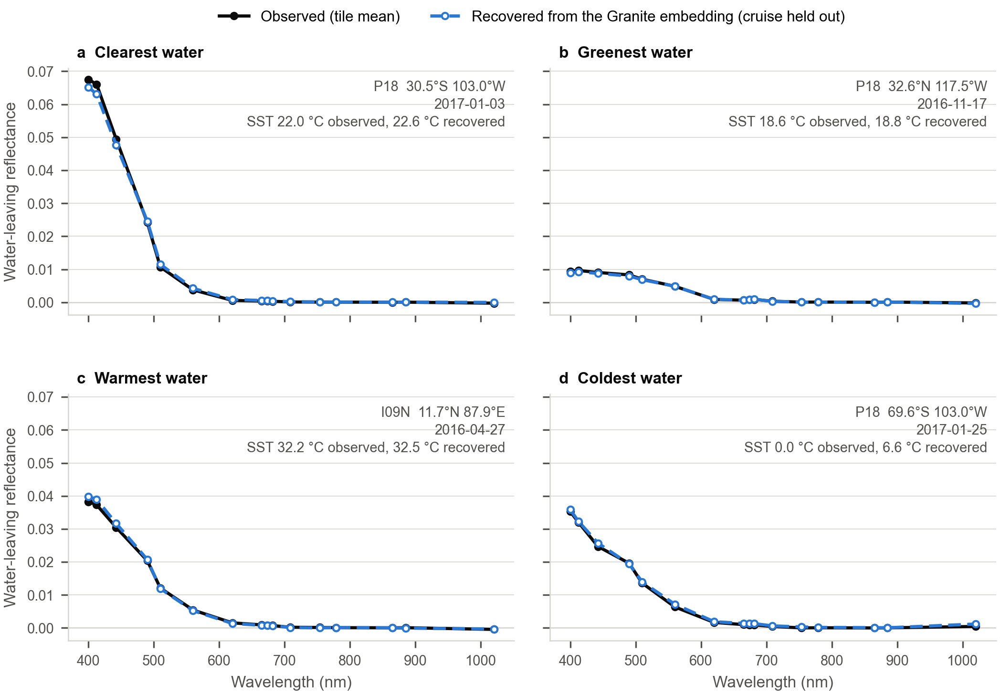
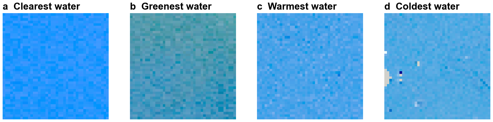

# Figures

One entry per figure: what it shows, the code that makes it, its inputs, and how
to regenerate it. Outputs go to `figures/output/` (committed). Inputs under
`data/` are not in git; they live on the cluster or are copied back as noted.

Shared conventions: Arial, no titles baked into the image (captions go in the
text), observed values in black, model-derived values in blue (#2a78d6) and dashed.

The figure scripts need numpy, pandas, matplotlib and scikit-learn. Run them with
a Python that has these; on the project owner's laptop that is
`/Users/hellpark/miniforge3/bin/python` (the default `python3` there lacks
matplotlib).

## Spectral recovery from Granite embeddings

- **Shows:** for four contrasting samples, the tile's observed mean water-leaving
  reflectance at each OLCI wavelength (black) and the same spectrum recovered
  linearly from the tile's 512-number Granite embedding (blue, dashed), with
  observed and recovered SST. Evidence that the embeddings retain the absolute
  colour and temperature of the water.
- **Method:** ridge regression from embedding to each channel's tile mean, over
  all 3,503 tiles, cross-validated with whole cruises held out (5 folds grouped by
  cruise); the plotted recovery for each tile comes from a model that never saw
  its cruise. Samples: among best fixed tiles at least 95% clear with SST and
  well-behaved visible reflectances (all positive, 560 nm above 0.002), the
  clearest and greenest (highest and lowest 443/560 nm ratio), the warmest and the
  coldest. Panel d shows the weakest case: at 0 C the recovered SST is 6.6 C,
  because very cold tiles are rare (Granite also excluded polar water from
  pretraining).
- **Code:** `figures/make_spectral_recovery.py`
- **Inputs:** `data/embeddings/` tile_embeddings.npy, tile_embeddings.csv,
  tile_raw_features.csv, sample_embeddings.csv (copied back from the cluster).
- **Regenerate:** `python figures/make_spectral_recovery.py`
- **Outputs:** `figures/output/spectral_recovery.png`, `.pdf`, and
  `spectral_recovery_tiles.csv` (the four tiles: sample, scene, date, position,
  tile path).

### Companion: natural-colour images of those four tiles

- **Shows:** the four 42 x 42-pixel tiles (12.6 km across) behind panels a-d, in
  natural colour with one shared stretch, so differences in colour are real:
  deep blue for the South Pacific gyre (a), blue-green off southern California
  (b), lighter blue for the Bay of Bengal (c) and the Antarctic margin (d). Flagged
  pixels are grey (a few at the left edge of d). The pixel-to-pixel speckle is
  sensor noise at 300 m; open-ocean tiles have little real structure at this
  scale.

- **Code:** `figures/make_tile_rgb.py figures/output/spectral_recovery_tiles.csv`
- **Inputs:** the four tile files listed in `spectral_recovery_tiles.csv`, copied
  from the cluster to the same relative paths under `data/tiles/`.
- **Output:** `figures/output/spectral_recovery_tile_rgb.png` (1 x 4 strip, shared
  colour stretch, flagged pixels grey).
- The full scenes (with a quick-look JPEG inside each archive) are the products
  named in the `granule_id` column, in `data/products/olci/` on the cluster.
